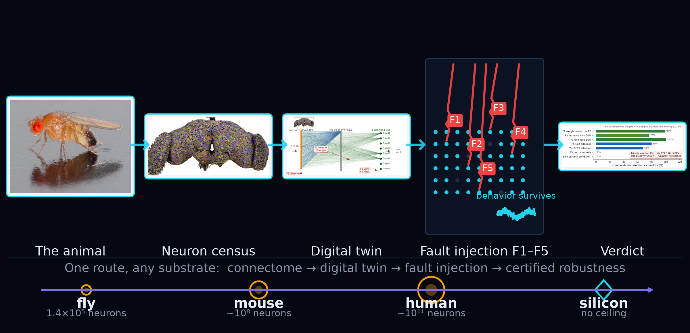
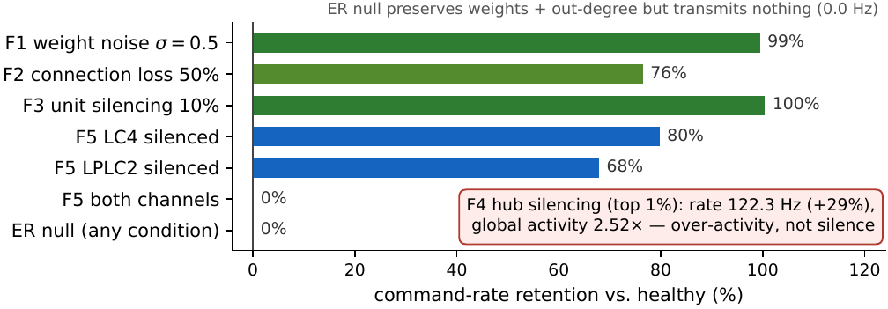
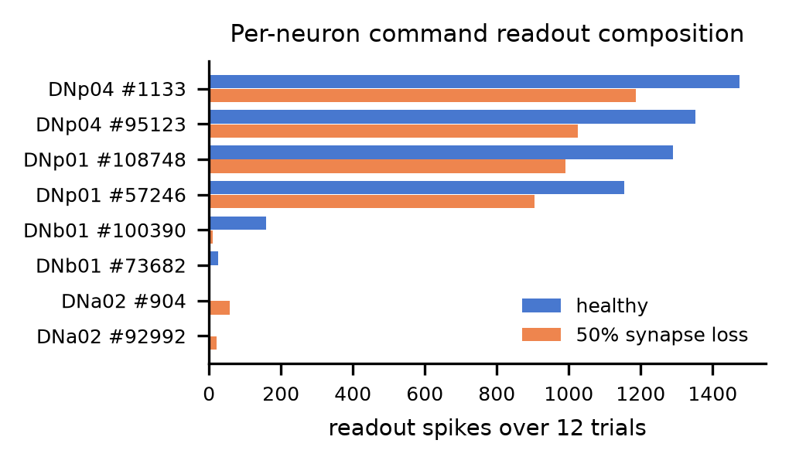

<h1 align="center">How Much Fault Tolerance Is in a Fly Brain?</h1>

<p align="center">
<b>Fault-Injection Analysis of a Whole-Connectome Spiking Controller</b><br>
Shuchao Gao · Waseda University · <i>ISCAS 2027 submission</i>
</p>

<p align="center">


</p>

---

<p align="center">

</p>

**From animal to verdict in one pipeline.** The animal (CC BY-SA 2.5 photo) → its brain, every cell type rendered (FlyWire) → the digital twin, built from real connectome edges → fault injection at five scales (F1–F5) → the verdict. The roadmap holds for any substrate: the same five steps consume any connectome, at any scale.

<h2 align="center">A whole brain, deliberately broken, that keeps driving</h2>

## What this repository is

The code injects five hardware-motivated fault families into the released leaky integrate-and-fire (LIF) whole-brain model of *Drosophila melanogaster* (138,639 neurons, 15,091,983 signed synapses, FlyWire connectome) and measures behavioral outcome on the visuomotor escape pathway: 150 Hz Poisson drive to the LC4 + LPLC2 populations (314 cells), scored as the population firing rate of the 8 descending command neurons.

**36 conditions × 12 seeded 600 ms trials each** (≈3.5 s per trial on one CPU core). Every trial restores the full network state from the same healthy snapshot; fault realizations are derived from SHA-256 seeds over (condition, trial), so F1–F3 faults are independently redrawn per trial while F4/F5 lesions are fixed. Determinism covers the connectome, the state, and the fault seeds. The stimulus Poisson stream is not re-seeded per trial (it keeps advancing across trials, as it would on repeated hardware runs), so re-runs are statistically equivalent rather than bit-identical; the archived per-trial records are the canonical realization. There is no whole-brain background drive: baseline firing is zero, and every recorded spike traces back to the directly stimulated sensory cells.

### The instrumented pathway

<p align="center">

</p>

**Fig. 1 — The instrumented escape pathway (real connectome data).** 314 looming-sensitive sensory cells (LC4, 104 cells, blue; LPLC2, 210 cells, orange) converge through the top-ranked two-hop relays (top 90 of 849 candidates) onto 8 command descending neurons. All drawn edges are real FlyWire connectome edges (594 direct sensory→DN); line opacity and width scale with synapse count. Red badges F1–F5 mark the five fault-injection points. Inset: FlyWire brain rendering, adapted from Dorkenwald et al., *Nature* 634, 124–138 (2024), CC BY 4.0.

## What the experiment identifies

The sweep is not just a stress test — it is a **diagnosis**. Three things fall out that no single-component benchmark gives you:

1. **Where the single point of failure lives.** Silencing *both* sensory channels is the only catastrophic mode (0.0 Hz, every trial); the residual 21.2k spikes are, by construction, the stimulated sensory cells themselves — all their outputs are severed and the non-stimulated brain, initialized at zero baseline, receives no input. The sensor interface, not the network, is what must be duplicated.
2. **The silent killer.** Removing the top-1% hubs makes the command rate *rise* 29% with 2.52× global activity — output violates its envelope while **every per-unit monitor still reads "active"**. Only fault injection exposes this mode; liveness monitoring cannot.
3. **A certifiable envelope.** Every pass/fail verdict is unchanged for any decision threshold between 9.2 and 63.1 Hz, and a second, activity-envelope criterion (rate *and* total spikes within 2× the healthy median) flags the hub-loss dysregulation mode that rate-only scoring misses: F4_hub_1pct passes transmission 12/12 but violates the envelope 12/12.

## Applications

- **Pre-deployment certification of neuromorphic controllers** — seconds-per-trial fault-injection campaigns as a standard gate before embodied hardware ships.
- **Where to spend hard silicon** — the sweep tells you which redundancy pays (sensory front-end) and which does not (weight precision): dense low-precision, partially defective fabrics are tolerated by this architecture.
- **Envelope monitors for autonomous systems** — the hub-loss dysregulation mode argues for output-envelope supervision, not component liveness checks, in safety-critical loops.

## Beyond the fly

The pipeline is species-agnostic by construction: image → connectome → digital twin → fault injection → certified robustness. The same five steps run unchanged on any connectome-scale controller — mouse (~10⁸ neurons), human (~10¹¹), or engineered silicon systems with arbitrary topologies. What scales is the certification, not the method.

## Results at a glance

<p align="center">

</p>

| Condition | Command rate (median) | vs. healthy (94.7 Hz) | Note |
|---|---|---|---|
| Healthy | 94.7 Hz (94.0–95.6) | — | 4.05 ms first-spike latency |
| Random-drive control | 8.2 Hz | 9% | total spikes 293k vs 40k — specificity, not arousal |
| F1 weight noise, σ = 0.5 | 94.2 Hz | 99% | median within healthy trial dispersion |
| F2 synapse loss, 50% | 72.4 Hz | 76.5% | latency 4.05 → 5.4 ms (+33%) |
| F3 unit loss, 10% (~14k neurons) | 95.1 Hz | 100% | flat through the dose (a hair above baseline) |
| F4 hub loss, top 1% (9.1% of synapses) | 122.3 Hz (121.1–123.9) | **+29%, 2.52× global activity** | dysregulation, not silence |
| F5 both sensory channels silenced | 0.0 Hz (every trial) | 0% | the only catastrophic mode; the 21.2k residual spikes are the driven sensory cells themselves (no background drive) |
| Permuted null (edge retargeting) | 0.0 Hz (median, every condition) | — | transmits nothing; broad activity ~24k spikes, barely above the 21.2k driven-cell baseline (≈2.6k propagated) |

## The three findings

<p align="center">

</p>

**Fig. 2 — The readout is pathway-specific.** Escape drive pushes the command population to 94.7 Hz; an equal-sized random set, driven identically, yields 8.2 Hz while producing *more* total activity (293k vs 40k spikes). Silencing both sensory channels (F5_both) drops the command rate to exactly zero in every trial; the residual global activity is the stimulated sensory cells themselves (see the determinism note above).

<p align="center">

</p>

**Fig. 3 — Dose–response.** (a) Synapse deletion degrades gracefully: 50% loss still retains 76.5% of the command rate, with the cost appearing almost entirely in latency (+33%), consistent with recruitment of longer residual multi-hop routes. (b) Hub removal is non-monotone and qualitatively different from every distributed fault: removing the top-1% hubs *raises* the command rate +29% with 2.5× global activity — over-drive, not silence.

<p align="center">

</p>

**Fig. 4 — The dangerous failure mode is dysregulation.** The top-1% hub set carries ~60% inhibitory output synapses (network mean 40%), so hub loss removes broad inhibitory regulation rather than starving the pathway — output violates the envelope while every per-unit monitor still reads "active". The same lesion on the permuted control does not produce this signature, binding the effect to biological hub structure rather than degree heterogeneity.

<p align="center">

</p>

**Fig. 6 — Aggregates hide composition.** Four of the eight command cells carry 96.6% of healthy readout spikes; at 50% synapse loss the smallest contributors collapse (158→10 and 26→0 spikes over 12 trials) while previously silent cells are recruited (1→58, 0→21). The aggregate retains 76.9%, so the tolerance curves should be read as a descending-population response, not as behavior.

An edge-permuted null (postsynaptic partners reshuffled, preserving each neuron's out-degree, weight profile, and the global incoming-degree histogram) transmits nothing at the command readout, while an analytic multi-hop pathway-mass analysis shows that *relative* route-mass decay under edge loss is topology-independent. Conclusion: functional robustness arises from **threshold amplification acting on convergent wiring**, not from graph redundancy alone. See [`REPORT_zh.md`](REPORT_zh.md) for a detailed Chinese walkthrough of every experiment, and [`paper/main.pdf`](paper/main.pdf) for the paper itself.

## Repository layout

```
├── paper/                 LaTeX source of the paper + figure PDFs
├── docs/img/              PNG renders of the paper figures (used by README/REPORT)
├── sim/
│   ├── engine.py          network construction + fault injection + trial runner (Brian2)
│   ├── calibrate.py       background calibration + θ placement (10-trial set)
│   ├── sweep.py           fault sweep over all 36 conditions (writes results/)
│   ├── analyze.py         dose-response figures from results/
│   ├── envelope.py        two-criterion scoring: transmission + activity envelope
│   ├── pathway_analysis.py  analytic multi-hop pathway mass m_k = ||A^k||_1
│   ├── fig_pathway.py     real-data escape-pathway figure (Fig. 1)
│   ├── fig_neuron.py      per-neuron command readout composition (README)
│   ├── fig_glance.py      results-at-a-glance bar chart (README)
│   ├── data/annotations.tsv   FlyWire cell-type annotations (see Credits)
│   ├── results/           per-trial JSONL records, calibration, summary.json, pathway_mass.json
│   └── figs/              generated figure PDFs
```

## Setup

```bash
python3 -m pip install -r requirements.txt
```

The connectome itself is **not** bundled here. Clone the released model and place it next to this repository:

```bash
git clone https://github.com/philshiu/Drosophila_brain_model.git
# directory layout expected by the code:
#   <parent>/Drosophila_brain_model/   (Connectivity_783.parquet, Completeness_783.csv, ...)
#   <parent>/sim/                      (this repository)
```

## Reproduce

All runs are seeded and reproducible: the connectome, the healthy state snapshot, and the fault seeds are fixed; per-trial fault realizations are drawn from SHA-256 seeds over (condition, trial) so F1–F3 replicate hardware draw-to-draw variability. The stimulus stream is not re-seeded, so re-runs are statistically equivalent rather than bit-identical; the archived per-trial records are the canonical realization, and every number in the paper is reproducible from them.

```bash
cd sim
python3 calibrate.py           # ~1 min: background stats + threshold (10-trial set)
python3 sweep.py               # ~1 h single core: 36 conditions x 12 trials (real + ER)
python3 pathway_analysis.py    # ~1 min: multi-hop route-mass analysis
python3 analyze.py             # regenerates figs 2-4 (writes sim/figs/, copy to paper/figs/)
python3 envelope.py            # transmission vs activity-envelope verdict table (Table I P4)
python3 fig_pathway.py         # regenerates Fig. 1 (writes sim/figs/ and paper/figs/)
python3 fig_glance.py          # regenerates the README results-at-a-glance chart
python3 fig_neuron.py          # per-neuron composition: healthy vs 50% synapse loss
```

Runtime: ≈3.5 s per 600 ms trial on one CPU core; the full sweep is minutes-to-an-hour on a laptop. Figures are written with embedded TrueType (Type 42) fonts to comply with IEEE PDF specifications (no Type 3 fonts).

## Output format

- `sim/results/real/*.jsonl`, `sim/results/er/*.jsonl` — one JSON record per trial: condition, seed, command rate, broad-readout rate, first-spike latency, total spikes.
- `sim/results/calib/calibration.json` — healthy/random calibration distributions and θ.
- `sim/results/summary.json` — per-condition medians, interdeciles, success fractions.
- `sim/results/graph/pathway_mass.json` — route mass m_k per graph per edge-loss level.

## Credits

- Whole-brain LIF model and connectome tables: [philshiu/Drosophila_brain_model](https://github.com/philshiu/Drosophila_brain_model)
- Connectome: FlyWire Consortium — Dorkenwald et al., *Nature* 634, 124–138 (2024), doi:10.1038/s41586-024-07558-y (CC BY 4.0); cell-type annotations via Schlegel et al. 2023 (codex.flywire.ai).
- Escape-pathway neurobiology: Shuang et al. 2023; Fu & Card 2020 (see paper references).
- Fruit-fly photograph in the hero banner: André Karwath, Wikimedia Commons, CC BY-SA 2.5. The hero banner is a composite schematic (photo + FlyWire rendering + this repo's figures); the fault-injection panel is illustrative.

## License

MIT (see `LICENSE`). The bundled `sim/data/annotations.tsv` derives from the FlyWire annotation release (CC BY 4.0); the upstream connectome files remain under the terms of the original model repository.
