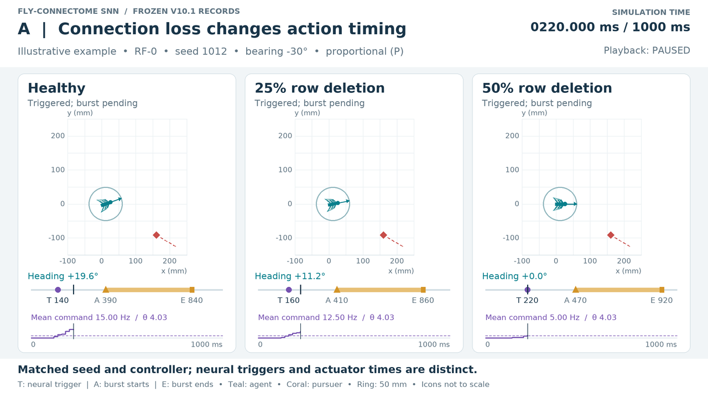
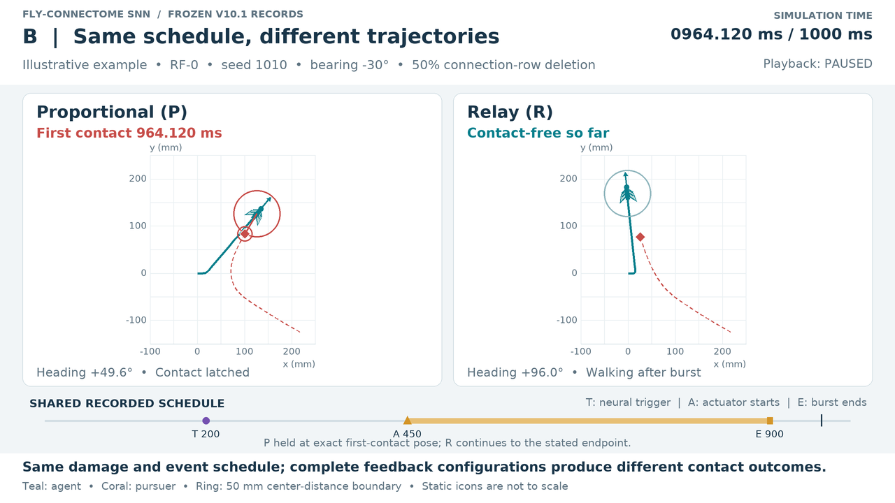
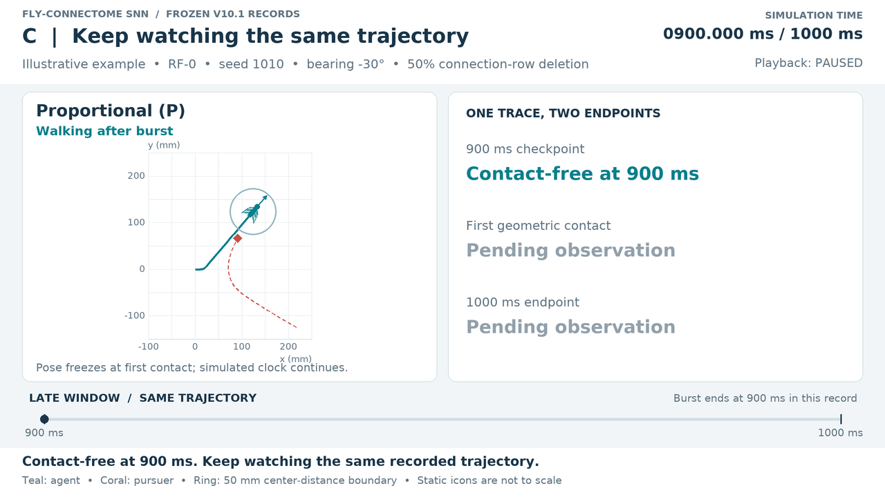

# From Connection Loss to Collision

What happens to **action timing, motion and collisions** when connections are deleted from a spiking network built from the fruit fly's brain wiring diagram?

[Paper](https://github.com/Scophield/drosophila-fault-injection/blob/22999d28d8fe22f863fc8f62eaa45a57256083d0/paper/iscas2027-v10.1-count-candidate.pdf) · [Demos](#demos) · [Results](#results) · [Reproduce](#reproduce) · [Code & Data](#code-and-data)

*Research manuscript · V10.1 · Synthetic pursuit–escape task*

<p align="center">
<a href="media/paper-v10.1/overview.mp4"></a>
</p>

**Watch the action clock, then the outcome.** These record-linked replays compare connection deletion, feedback law and observation horizon. The overview cuts between three illustrative examples; its labelled simulation clock resets at each cut.

[Overview MP4 · 26 s](media/paper-v10.1/overview.mp4) · [Static poster](media/paper-v10.1/overview.png) · [Example identities and source hashes](docs/homepage-animation/examples.json)

## Three findings

1. **Connection loss shifts action timing.** With 50% connection-row deletion, paired neural triggers occur **80.0 / 57.5 / 57.5 ms later on average** in RF-0/A/B. These retrospective measurements describe sampled action decisions. [Timing demo](#a-connection-loss-and-action-timing) · [Paired data](https://github.com/Scophield/drosophila-fault-injection/blob/22999d28d8fe22f863fc8f62eaa45a57256083d0/output/trigger-timing-20261025-03/all-healthy-fault-pairs.csv)
2. **The same action schedule can yield different outcomes.** All **288 P/R pairs** share trigger and burst schedules; **15 pairs** nevertheless have different contact outcomes under their complete control configurations. [Control demo](#b-same-schedule-different-outcome) · [All P/R pairs](https://github.com/Scophield/drosophila-fault-injection/blob/22999d28d8fe22f863fc8f62eaa45a57256083d0/output/trigger-timing-20261025-03/all-P-R-pairs.csv)
3. **The endpoint changes the verdict.** The same RF-0 proportional, 50%-deletion trajectories are contact-free in **46/48** cases at 900 ms and **37/48** at 1000 ms. [Horizon demo](#c-one-trajectory-two-observation-endpoints) · [Endpoint data](https://github.com/Scophield/drosophila-fault-injection/blob/22999d28d8fe22f863fc8f62eaa45a57256083d0/output/trigger-timing-20261025-03/all-contact-pairs.csv)

## Demos

The network commands a simulated agent pursued by a moving threat; these are not biological fly recordings. Teal marks the agent and coral the pursuer. The ring marks **50 mm center separation**; icon sizes are decorative. Open an MP4 for full-size labels and event timing.

### A. Connection loss and action timing

RF-0, seed 1012, −30°, proportional feedback: healthy / 25% / 50% deletion. Watch **neural trigger → actuator onset → burst end**; this matched example illustrates timing shifts, not a universal monotonic response.

[MP4 · 17 s](media/paper-v10.1/demo-a-delay.mp4) · [GIF](media/paper-v10.1/demo-a-delay.gif) · [Poster](media/paper-v10.1/demo-a-delay.png) · [Sources](docs/homepage/EVIDENCE.md#selected-examples)

<details>
<summary>Show the timing-comparison poster</summary>



</details>

### B. Same schedule, different outcome

RF-0, seed 1010, −30°, 50% deletion: proportional (P) and relay (R) share the mask and **200 / 450 / 900 ms** trigger/onset/end schedule. P first contacts at **964.120 ms**; R is contact-free through 1000 ms. This compares complete feedback configurations, including their differing healthy reserve.

[MP4 · 17 s](media/paper-v10.1/demo-b-control.mp4) · [GIF](media/paper-v10.1/demo-b-control.gif) · [Poster](media/paper-v10.1/demo-b-control.png) · [Pairing evidence](docs/homepage/EVIDENCE.md#selected-examples)

<details>
<summary>Show the synchronized P/R poster</summary>



</details>

### C. One trajectory, two observation endpoints

Continue B's proportional trajectory: **contact-free at 900 ms**, first contact at 964.120 ms, then the latched outcome at 1000 ms. This is one trajectory viewed twice; contact-free through an endpoint does not mean permanent escape.

[MP4 · 18 s](media/paper-v10.1/demo-c-horizon.mp4) · [GIF](media/paper-v10.1/demo-c-horizon.gif) · [Poster](media/paper-v10.1/demo-c-horizon.png) · [Replay and selection](docs/homepage/EVIDENCE.md)

<details>
<summary>Show the observation-horizon poster</summary>



</details>

All clips are **retrospectively selected illustrative examples**, not incidence estimates. Positions, headings and clocks follow verified original plant segments; no new neural simulation or trajectory was generated. Pauses and playback factors are labelled separately from simulation time. [Media provenance and reproduction](docs/homepage/REPRODUCE.md)

## Results

**Contact-free tasks under 50% connection-row deletion.** P = proportional; R = relay. Each fraction counts two bearings per seed for one law and one deletion condition.

| RF | Law | 900 ms | 1000 ms |
|---|---|---|---|
| RF-0 | P | 46/48 | 37/48 |
| RF-0 | R | 48/48 | 48/48 |
| RF-A | P | 23/24 | 22/24 |
| RF-A | R | 23/24 | 23/24 |
| RF-B | P | 24/24 | 23/24 |
| RF-B | R | 24/24 | 24/24 |

The campaigns contain **576 test episodes** in **24 / 12 / 12 independent seed clusters** in RF-0/A/B. Each seed includes two bearings, two laws and healthy/25%/50% deletion. The two horizons rescore the same trajectories; they add no independent samples. [Statistical definitions, confidence intervals and evidence index](docs/homepage/EVIDENCE.md#full-cohort-results)

**Activity and task failure are distinct endpoints.** The frozen 400-ms command warning detects **2/13, 2/3 and 0/1** contacts in RF-0/A/B and also raises false alarms. Pairing/clock checks and independent replay test data consistency, with limited reuse on a delayed-tank adapter. [Warning results and checker scope](docs/homepage/EVIDENCE.md#warnings-and-executable-checks)

## Scope

These findings concern one connectome-derived model, assumed sensory mappings and a synthetic task. RF-A/B change mapping draws, recalibration and test cohorts together; smaller, uncertain law contrasts do not isolate an RF effect. P/R differences retain unequal healthy control reserve. Trigger timing is retrospective and descriptive; one burst followed by slower motion makes 1-s performance a finite-horizon result.

## Reproduce

Use the documented Python 3.12 environment for this **fixed scientific snapshot**:

```sh
git clone --single-branch --branch artifact/iscas2027-v10.1-submission-final https://github.com/Scophield/drosophila-fault-injection.git science-v10.1
cd science-v10.1
git checkout --detach 22999d28d8fe22f863fc8f62eaa45a57256083d0
python tools/verify_v10_1.py
python -m unittest discover -s tests -p 'test_*v10*.py' -v
```

Saved-record verification needs no neural simulation or external connectivity matrices. [Environment and full reproduction](https://github.com/Scophield/drosophila-fault-injection/blob/22999d28d8fe22f863fc8f62eaa45a57256083d0/REPRODUCE.md) · [Animation reproduction](docs/homepage/REPRODUCE.md) · [External inputs and licensing](https://github.com/Scophield/drosophila-fault-injection/blob/22999d28d8fe22f863fc8f62eaa45a57256083d0/docs/THIRD_PARTY_INPUTS_V10.md)

## Code and Data

- [Fixed paper and LaTeX](https://github.com/Scophield/drosophila-fault-injection/tree/22999d28d8fe22f863fc8f62eaa45a57256083d0/paper) · [Fixed source and records · `22999d2`](https://github.com/Scophield/drosophila-fault-injection/tree/22999d28d8fe22f863fc8f62eaa45a57256083d0)
- [Data index](https://github.com/Scophield/drosophila-fault-injection/blob/22999d28d8fe22f863fc8f62eaa45a57256083d0/docs/V10_DATA_INDEX.md) · [Publication identities](https://github.com/Scophield/drosophila-fault-injection/blob/22999d28d8fe22f863fc8f62eaa45a57256083d0/PUBLICATION.md) · [SHA256 manifest](https://github.com/Scophield/drosophila-fault-injection/blob/22999d28d8fe22f863fc8f62eaa45a57256083d0/PUBLIC_SCOPE.json)
- [Manuscript branch](https://github.com/Scophield/drosophila-fault-injection/tree/artifact/iscas2027-v10.1-submission-final) — a moving entry; use the fixed commit above for reproduction.

### Cite this research

Shuchao Gao. *From Connection Loss to Collision: Closed-Loop Fault Assessment of a Fly-Connectome SNN*. Research manuscript, 2026. [Fixed research snapshot](https://github.com/Scophield/drosophila-fault-injection/tree/22999d28d8fe22f863fc8f62eaa45a57256083d0). Status: research manuscript prepared for IEEE ISCAS 2027.

### History

[Earlier protocols and versions](docs/homepage/HISTORY.md) preserve the original project page, figures and 3.13-s escape clip. They describe a different protocol and are not the experimental evidence shown above.
