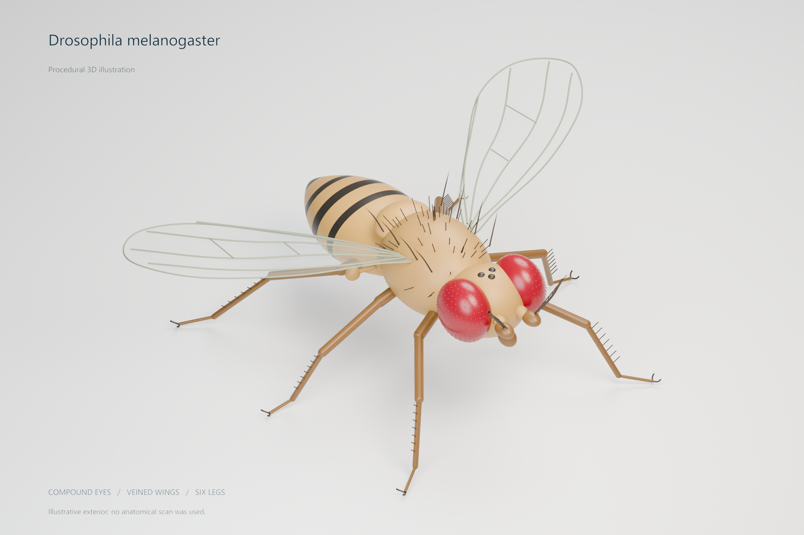
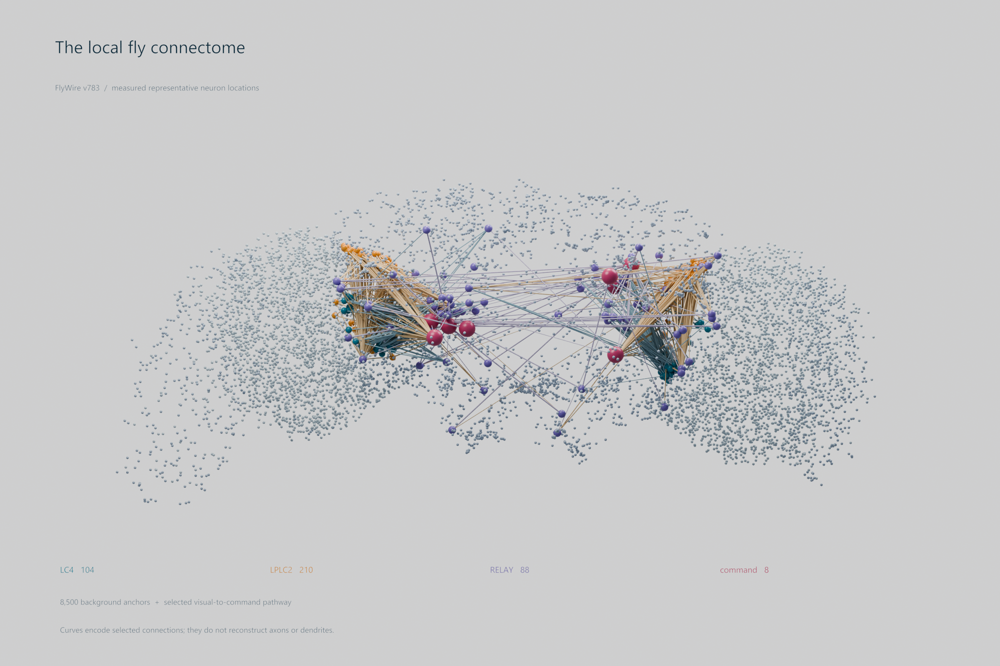
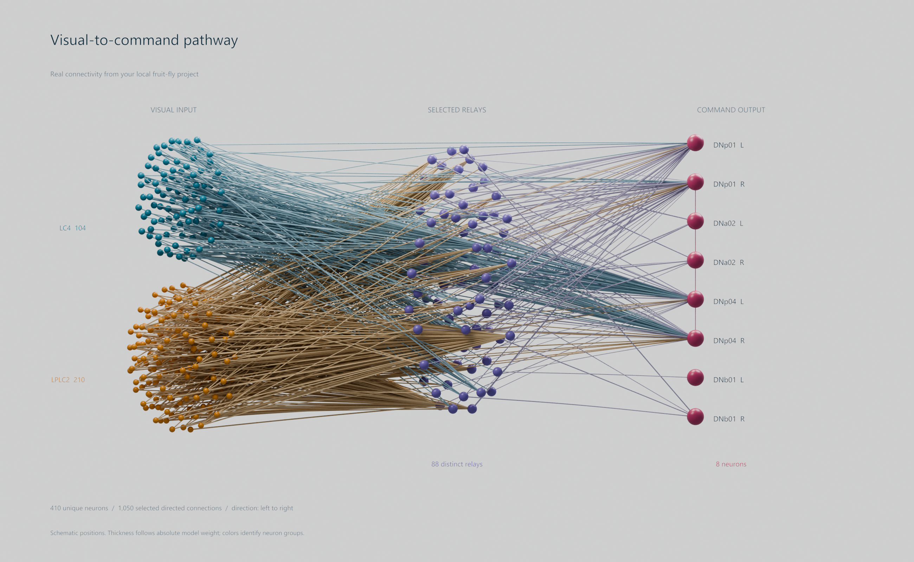
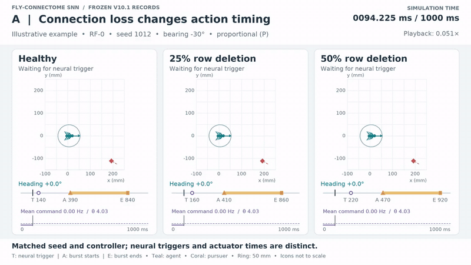
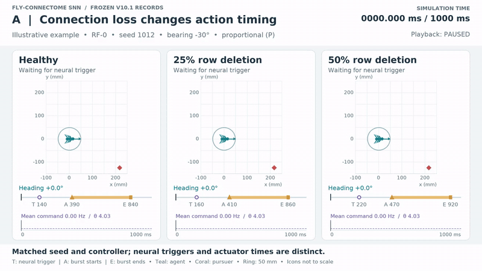
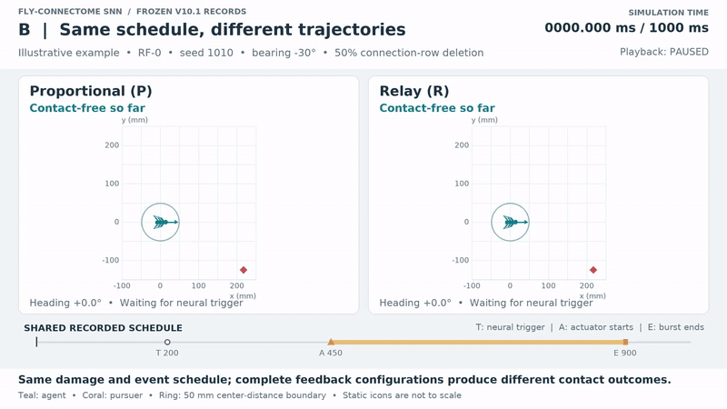
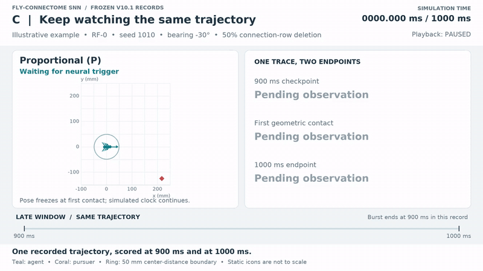
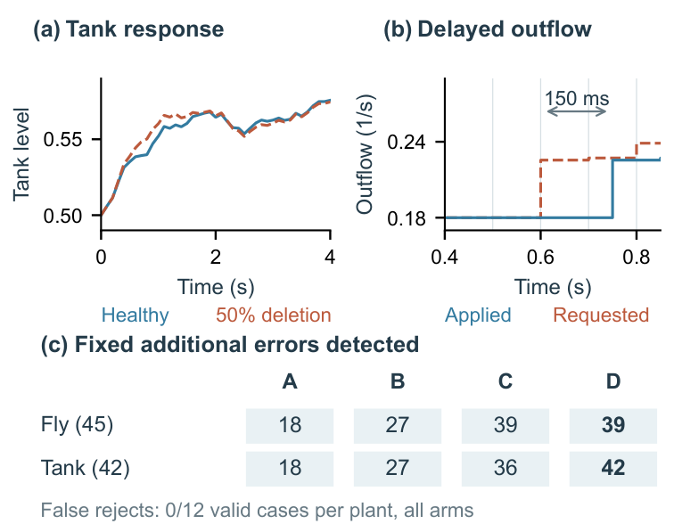
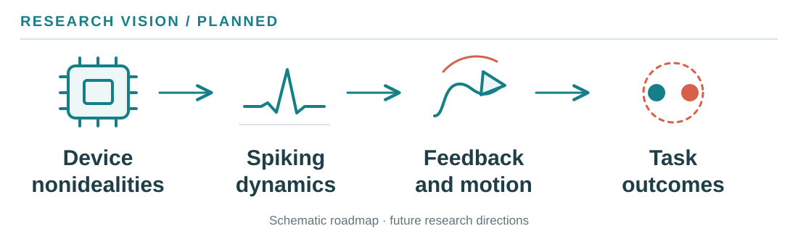

# From Connection Loss to Collision

**138,639 spiking neurons. Break connections. Watch the consequences.**

[Read the paper](https://github.com/Scophield/drosophila-fault-injection/blob/f58968795e9a325d88d478851bdb270d5389c5e5/paper/iscas2027-v10.1-count-candidate.pdf) · [Watch](#demos) · [Evidence](#measured-evidence) · [Reproduce](#reproduce) · [Future directions](#future-directions)

## From brain wiring to action

<p align="center">
<a href="media/showcase/fruit_fly.png"></a>
<a href="media/showcase/connectome.png"></a>
<a href="media/showcase/visual_pathway.png"></a>
</p>

**Illustrative animal → connectome-derived network → visual-to-command pathway.** Selected neurons and connectivity follow the source model. Open the original-resolution images; curves depict connectivity, not measured neurite shapes. [Sources and attribution](docs/showcase/PROVENANCE.md)

| Neural substrate | Sensory input | Command readout | Paired evidence |
|---|---|---|---|
| **138,639** LIF neurons · **15.09 million** signed connection rows | **314** LC4/LPLC2 cells | **8** descending cells | **576** episodes · **3** sensory realizations · **2** feedback laws |

## Watch the action clock, then the outcome

<p align="center"><a href="media/paper-v10.1/overview.mp4"></a></p>

[Play the 26-second overview](media/paper-v10.1/overview.mp4) · [Poster](media/paper-v10.1/overview.png) · [Source identities and hashes](docs/homepage-animation/examples.json)

- **Connection loss shifts action timing.** At 50% connection-row deletion, paired neural triggers occur **80.0 / 57.5 / 57.5 ms later on average** in RF-0/A/B.
- **Shared timing does not fix the outcome.** All **288 P/R pairs** share trigger and burst schedules; **15 pairs** have different contact outcomes under their full feedback configurations.
- **The endpoint changes the verdict.** RF-0 proportional, 50%-deletion runs are contact-free in **46/48** cases at 900 ms and **37/48** at 1000 ms—the same trajectories, observed longer.

## Demos

**Teal: agent. Coral: pursuer. Ring: 50 mm center separation.** Each replay uses verified original motion segments, a common spatial scale and labelled simulation time/playback speed. Icons are decorative; open MP4 for the clearest labels.

### A. Connection loss → action timing

**RF-0 · seed 1012 · −30° · proportional · healthy / 25% / 50% deletion**

<p align="center"><a href="media/paper-v10.1/demo-a-delay.mp4"></a></p>

Watch **neural trigger → actual actuator onset → burst end**. This matched example reveals stage-specific timing; it does not establish a universal monotonic response.

[Play · 17 s](media/paper-v10.1/demo-a-delay.mp4) · [Poster](media/paper-v10.1/demo-a-delay.png) · [Selection and raw sources](docs/homepage/EVIDENCE.md#selected-examples)

### B. Same schedule → different outcome

**RF-0 · seed 1010 · −30° · 50% deletion · proportional (P) / relay (R)**

<p align="center"><a href="media/paper-v10.1/demo-b-control.mp4"></a></p>

The mask and **200 / 450 / 900 ms** trigger/onset/end schedule match. P first contacts at **964.120 ms**; R stays contact-free through 1000 ms. Watch the paths diverge. Full feedback configurations differ, including their healthy control reserve.

[Play · 17 s](media/paper-v10.1/demo-b-control.mp4) · [Poster](media/paper-v10.1/demo-b-control.png) · [Pairing and raw sources](docs/homepage/EVIDENCE.md#selected-examples)

### C. Same trajectory → different observation endpoint

**The same RF-0 / seed 1010 proportional record, continued without a new experiment**

<p align="center"><a href="media/paper-v10.1/demo-c-horizon.mp4"></a></p>

Pause at **900 ms: contact-free**. Continue to the actual first contact, then the **1000 ms** endpoint. A successful finite observation window does not imply permanent escape.

[Play · 18 s](media/paper-v10.1/demo-c-horizon.mp4) · [Poster](media/paper-v10.1/demo-c-horizon.png) · [Replay evidence](docs/homepage/EVIDENCE.md)

These are **retrospectively selected illustrative examples**; full-cohort results establish frequency. The animations add no neural experiment.

## Measured evidence

**50% connection-row deletion: contact-free tasks (P, R).** Each count includes two bearings per seed for one law. Both horizons rescore the same episodes.

| Sensory realization | 900 ms | 1000 ms |
|---|---|---|
| RF-0 | **46/48, 48/48** | **37/48, 48/48** |
| RF-A | **23/24, 23/24** | **22/24, 23/24** |
| RF-B | **24/24, 24/24** | **23/24, 24/24** |

RF-0/A/B have **24/12/12 independent seed clusters**. The 50%-deletion net-loss law contrast is **−22.9 pp** in RF-0 and a smaller, uncertain **−4.2 pp** in each new RF realization. Mapping draws, recalibration and test cohorts change together; they do not isolate an RF effect. [Intervals and statistical definitions](https://github.com/Scophield/drosophila-fault-injection/blob/f58968795e9a325d88d478851bdb270d5389c5e5/paper/iscas2027-v10.1-count-candidate.pdf)

**Early activity is not the task endpoint.** The frozen 400-ms command warning detects **2/13, 2/3 and 0/1** contacts in RF-0/A/B and also produces false alarms. [Exact-count warning protocol](https://github.com/Scophield/drosophila-fault-injection/blob/f58968795e9a325d88d478851bdb270d5389c5e5/docs/WARNING_COUNT_PROTOCOL_V10_1.md)

### Evidence checks that you can execute

<p align="center"><a href="media/showcase/v10_1_ablation.png"></a></p>

Common checks test pairs, clocks, exposure and labels; native replay independently checks plant/input behavior. On an **author-designed catalogue of 87 known corruptions**, combined checks find **81**, versus **36** for trusted-header checks, with **0/24** valid controls rejected. Six misses remain: trace consistency cannot authenticate neural execution. The delayed-tank adapter demonstrates reuse beyond the fly task.

[Fixed executed evaluation · `b29f089`](https://github.com/Scophield/drosophila-fault-injection/tree/b29f08970f7749c916a472e835517547d832e6cc) · [Per-case results, costs and scope](https://github.com/Scophield/drosophila-fault-injection/blob/f58968795e9a325d88d478851bdb270d5389c5e5/docs/ENGINEERING_EVALUATION_V10_1.md)

## Future directions

**Toward fault-aware neuromorphic autonomy: from device nonidealities to decisions, motion and task outcomes.**

<p align="center"><a href="media/showcase/research-vision.svg"></a></p>

Our next goals are to connect device-level fault models to this task-level evidence, extend single-burst trials to sustained avoidance, and test the interface across more plants and controllers.

## Reproduce

[Current paper and LaTeX · `f589687`](https://github.com/Scophield/drosophila-fault-injection/tree/f58968795e9a325d88d478851bdb270d5389c5e5/paper) · [Code and records](https://github.com/Scophield/drosophila-fault-injection/tree/f58968795e9a325d88d478851bdb270d5389c5e5) · [Environment and commands](https://github.com/Scophield/drosophila-fault-injection/blob/f58968795e9a325d88d478851bdb270d5389c5e5/REPRODUCE.md) · [Data index](https://github.com/Scophield/drosophila-fault-injection/blob/f58968795e9a325d88d478851bdb270d5389c5e5/docs/V10_DATA_INDEX.md)

```sh
git clone --single-branch --branch research/v10.1-abstract-context https://github.com/Scophield/drosophila-fault-injection.git science-v10.1
cd science-v10.1
git checkout --detach f58968795e9a325d88d478851bdb270d5389c5e5
python tools/verify_v10_1.py
```

Saved-record checks need no new neural simulation or external connectivity matrices. [Animation reproduction](docs/homepage/REPRODUCE.md) retains its **75313d7** generation and **22999d2** verification identities; these neural records are unchanged in the current paper. [Showcase provenance](docs/showcase/PROVENANCE.md)

<details>
<summary>Scientific scope, attribution and preserved versions</summary>

The evidence concerns one connectome-derived model, assumed sensory mappings and a synthetic task—not biological fly recordings. Timing is retrospective; healthy P/R control reserve differs. One burst followed by slower motion makes success finite-horizon preservation, without establishing a universal deletion tolerance or hardware-certified reliability.

We connect a FlyWire-derived spiking network to a synthetic pursuit–escape task, remove connections, and follow the consequences from neural decisions to motion. Task outcomes and stage-specific observations are assessed separately.

Model code: Philip Shiu and Nico Spiller. Underlying connectome: FlyWire v783; cite Dorkenwald et al. and the upstream annotation works. The project's MIT software license does not relicense third-party datasets. [Image attribution](docs/showcase/PROVENANCE.md) · [Third-party inputs](https://github.com/Scophield/drosophila-fault-injection/blob/f58968795e9a325d88d478851bdb270d5389c5e5/docs/THIRD_PARTY_INPUTS_V10.md)

[Earlier project versions](docs/homepage/HISTORY.md) preserve the original page and 3.13-s clip. [Pre-showcase README source](docs/showcase/README-c6d5189.md) preserves the local `c6d5189` homepage. Fixed scientific versions and their paper references remain unchanged.

</details>

Shuchao Gao · Waseda University · Research manuscript prepared for IEEE ISCAS 2027.
