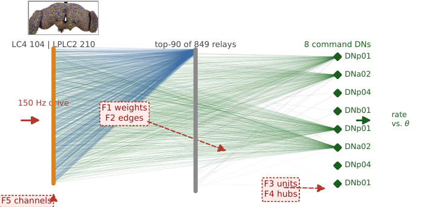
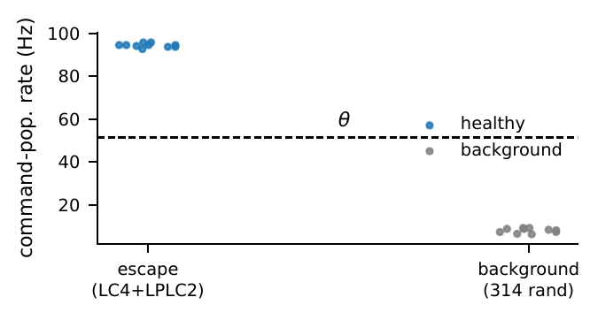
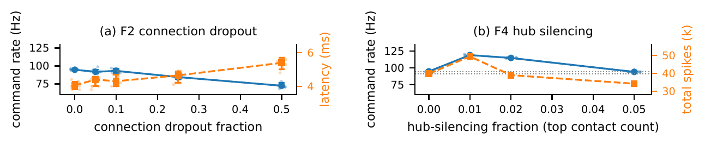
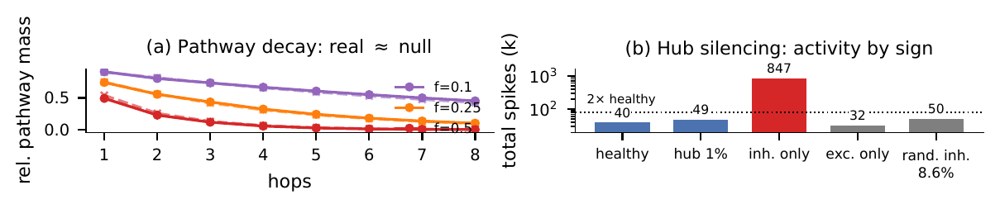

# 实验详细报告:果蝇全脑连接组控制器的故障注入分析

**对应论文**:*How Much Fault Tolerance Is in a Fly Brain? Fault-Injection Analysis of a Whole-Connectome Spiking Controller for Physical Intelligence*(Shuchao Gao, Waseda University;ISCAS 2027 投稿)
**本报告目的**:面向仓库读者与协作者,逐图逐数字解释"实验到底做了什么"。所有数字均可在 `sim/results/` 下精确复现(SHA-256 确定性种子)。

---

## 1. 实验要回答的问题

神经形态硬件正在把"控制器"做得越来越省电,但任何真实芯片都有坏点:权重不准(F1)、连线断了(F2)、核心死了(F3)、高扇出部件失效(F4)、传感器失联(F5)。工程上做的 spiking 网络是逐任务训练出来的,每一套设计的容错能力都要重新测一遍。**本实验利用一个"现成"的控制器——由完整突触接线图(连接组)直接构建、无需训练的果蝇全脑模型——系统测量它在上述五类故障下的行为输出,并把测量结果转写成硬件设计原则。**

一句话概括结果:**进化给的接线图对分布性损伤极其耐受(半数突触丢失仍保留 76% 行为输出、10% 神经元死亡无感、σ=0.5 的权重噪声完全吸收),唯一灾难性失效是感觉接口整体断联,最危险的是"高扇出 hub 丢失导致全局活动失控"(2.5× runaway)——一种所有单元监控都显示"活着"的过调失效。**

## 2. 被试系统:全脑 LIF 模型

- 来源:Shiu 等发布的 `Drosophila_brain_model`(Brian2 实现),基于 FlyWire v783 成年果蝇全脑连接组。
- 规模:**138,639 个**LIF 神经元,**15,091,983 条**带符号突触(40% 抑制性);每个连接的权重 = 0.275 mV × 突触接触数(合计 54,492,922 个接触),符号由突触前细胞的神经递质预测决定。
- 神经元参数:阈值 −45 mV,复位 −52 mV,膜时间常数 τm = 20 ms,突触衰减 τ = 5 ms,不应期 2.2 ms,突触延迟 1.8 ms。
- 背景活动:由原模型标定过的 Poisson 背景驱动维持,使全脑处于与文献一致的自发活动状态。
- 工程细节(容错实验的关键):**每个 trial 开始时恢复完整网络状态**,因此所有条件共享完全相同的初始状态与背景随机数实现;单次 600 ms trial 在单 CPU 核约 3.5 s。

## 3. 行为任务:视觉运动逃逸通路

**图 1 | 被测逃逸通路(直接从连接组数据绘制)。** 左列:受驱动的 314 个感觉神经元(蓝 = LC4 104 个,橙 = LPLC2 210 个),每个点是一个真实神经元;中列:849 个二跳 relay 中按突触总量排名前 90 的真实神经元;右列:8 个命令下行神经元(绿色菱形,标注 DNp01/DNa02/DNp04/DNb01)。连线为真实突触连接,线宽与不透明度 ∝ 突触数(感觉→命令的 594 条直接边也在图中)。红色虚线徽章标注五类故障的注入位置:F5 打在输入通道上,F1/F2 打在突触上,F3/F4 打在单元与 hub 上;左侧红色箭头为 150 Hz 驱动,右侧绿色箭头为读出(命令群体速率 vs θ)。内嵌小图:FlyWire 重建的成年果蝇全脑渲染图,自 Dorkenwald et al., *Nature* 634:124–138 (2024),CC BY 4.0。

**任务设计**:对 LC4+LPLC2 施加独立的 150 Hz Poisson 电流(模拟 looming 视觉刺激的持续高发放成分;原模型的逼近动力学不含时间紧迫度,故用恒定速率驱动,论文 III-B 有明确声明),读出为命令神经元群体在全程 600 ms 内的发放速率 r(t)(逐 trial 独立统计),对照阈值 **θ = 51.4 Hz** 判成功/失败。次要读出为全部 1,299 个下行神经元的群体速率,用于排除"8 神经元读出是挑选出来的"质疑。

**阈值标定与鲁棒性**(10-trial 校准集):逃逸驱动下命令群体 94.6 Hz(十分位 93.6–95.8,首尖峰延迟 4.4 ms);同等规模随机神经元集合被同样驱动时仅 8.2 Hz(6.4–9.2)。θ 取两者中点 51.4 Hz。**逐 trial 端点验证:任取 9.2–63.1 Hz 之间的阈值,下文所有通过/失败判定不变。** 正式扫描基线(12-trial 集)为 94.7 Hz(94.0–95.6),延迟 4.05 ms。

## 4. 五类故障注入(F1–F5)

所有故障在状态恢复之后注入、并在一个条件的 12 个 trial 内保持不变;实现由 SHA-256 派生的确定性种子驱动。

| 家族 | 操作 | 剂量 | 硬件对应 |
|---|---|---|---|
| **F1 权重变异** | 每条突触权重乘 i.i.d. 对数正态因子 | σ ∈ {5, 10, 20, 50}% | 模拟权重 variability、低位宽量化误差 |
| **F2 突触删除** | 随机删除突触 | f ∈ {5, 10, 25, 50}% | 互连/阻变器件失效 |
| **F3 随机单元损失** | 随机抽神经元,静默其全部输出突触(输入与读出细胞除外) | f ∈ {1, 2, 5, 10}% | 死核/死单元 |
| **F4 hub 损失** | 同 F3,但目标是按**总输出突触数**排名的前 1%/2%/5% 单元(1% = 1,386 个细胞,占全部突触 9.1%;三档分别占 9–22%) | | 高扇出部件失效(相关性损伤) |
| **F5 通道去传入** | 静默单侧(LC4 或 LPLC2)或双侧感觉通道的全部输出 | | 传感器/传入通路失效 |

条件总数:(4+4+4+3+3)×2 = **36 个条件**(同一扫描在真实连接组与 ER 对照网络上各跑一遍),每条件 12 trial。

## 5. 对照设计

1. **ER 零假设网络**:随机重连每条突触的突触后端点——保持出度、权重与符号,破坏入度结构与汇聚 motifs。它回答"容忍度是不是任何稀疏图都有"。
2. **解析通路质量**:对两个图计算 m_k = ‖Aᵏ‖₁(感觉→命令子矩阵,A 取突触计数),即 k 跳有向通路的突触加权质量,在完整图与各 F2 删除水平下计算。它把"拓扑冗余"与"动力学放大"分离。
3. **随机驱动对照**(III-B):同等规模随机神经元集合接受与逃逸相同的驱动——检验读出是通路特异还是全局唤醒。

## 6. 结果(逐图)

### 图 2:读出是通路特异的,不是"全局唤醒"

**图 2 | 读出特异性。** 逃逸刺激(LC4+LPLC2,12 trial)与等规模随机集合刺激下命令群体速率的对比(每点一个 trial;虚线为 θ=51.4 Hz)。逃逸驱动将命令群体推至 94.7 Hz(94.0–95.6),随机驱动仅 8.2 Hz;关键的反转在于**总活动**:随机刺激下全脑发放更多(293k vs 40k spikes)——命令速率的差异不是"脑子更活跃",而是**信号确实沿着被测通路传到了命令层**。双侧通道同时沉默(F5_both)时命令速率在每个 trial 都精确为 0,而全脑其余部分照常背景发放(总发放 21.2k spikes)——评分测的确实是"通过被测通路的信号传输"。

### 图 3:分布性损伤被优雅吸收;hub 损失导致失控

**图 3 | 行为容错曲线(12 trial 中位数;蓝:命令速率;橙:延迟或总发放)。** (a) F2 突触删除:5% 与 10% 删除后速率 91.9 与 93.1 Hz,25% 保留 84.5 Hz(89.2%),**50% 删除仍保留 72.4 Hz(76.5%)**,所有条件的 12 个 trial 全部通过;代价几乎全部体现在延迟上(4.05 → 5.4 ms,+33%)——符合"残余多跳更长通路被征用"的机制。(b) F4 hub 切除:非单调且与所有分布性故障定性不同——去 1% hub(占 9.1% 突触)命令速率**升到** 122.3 Hz(+29%;逐 trial 十分位 121.1–123.9),全局活动翻倍以上(99.9k spikes,健康值的 2.52 倍);2% 时速率仍高(117.1 Hz)而活动部分回落(42.4k);5%(22.4% 突触)时两项指标回到基线附近(94.2 Hz,36.4k)。机制:被移除的 hub 输出突触约 **60% 为抑制性**(网络均值 40%)——hub 切除没有饿死通路,而是解除了广泛连接的抑制性调控, spared 环路过度驱动命令层。在工程系统里这是危险模式:**输出违反包络,而每个单元健康监控都显示"active"**。同一损伤在 ER 网络上不产生此特征,把 runaway 绑定到生物 hub 结构而非度异质性本身。

**补充数字(F1/F3/F5,正文有述)**:F1 在 σ=0.5 时速率 94.2 Hz,中位数落在健康 trial 十分位带内(93.96–95.62),但 trial 离散度明显变宽(90.4–100.8)(总发放 39.7k→41.6k);F3 至 10%(≈14,000 个神经元连同其全部突触)无任何可测影响(95.1 vs 94.7 Hz)——命令驱动汇聚自数百个突触前群体,没有任何 10% 的切片是承重的;1,299 神经元宽读出同样跟踪该模式(健康 2,941 spikes vs 50% 突触丢失 1,918),说明渐降响应是命令编码的属性而非八神经元读出的 artifact。F5 单通道:LC4 沉默 75.5 Hz(保留 79.7%),LPLC2 沉默 64.3 Hz(67.9%),**最弱 trial 63.1 Hz 仍远高于 θ**;双通道 0%——**感觉接口是唯一单点失效**。

### 图 4:接线贡献的是什么——零假设网络与通路分析

**图 4 | 拓扑对比。** (a) F2 边删除下的多跳通路质量,各自归一到自身完整基线(实线:连接组,虚线:ER):**相对衰减几乎相同**(如 f=0.5、k=8 时 0.3% vs 0.4%),但绝对质量连接组高 5.8×(1 跳)至 17.7×(4 跳)。(b) hub 切除下的总活动(连接组 vs ER 零假设):**失控只出现在生物接线**;ER 零假设在所有条件下都传输为零(0.0 Hz,连 1,299 宽读出也是)。这组对照把"拓扑"与"动力学"分开:ER 网络保持了出度与权重,却没有可解码输出——**汇聚结构(入度组织)才是可解码性的来源**。

**中心机制:阈值放大。** 行为衰减(50% 突触丢失仍 76%)远慢于通路质量衰减(4 跳质量只剩 5.8%),指数型拓扑衰减被汇聚 spiking 动力学的阈值非线性转换为优雅的功能衰减。六行 mini 推导(论文 IV-D):N 个传入汇聚到一个命令神经元、每条突触独立存活概率 p 时,期望汇聚驱动线性缩放(Np),而 k 跳通路质量几何衰减(pᵏ;k=4、p=0.5 时 6.25%);阈值把汇聚驱动经饱和非线性映射到输出,在工作点附近速率随驱动变化缓慢——p=0.5 时速率保留 76.5%,高于线性 50% 驱动下界。**优雅退化需要两件事:保聚合驱动的汇聚接线 + 把驱动变化压缩为小速率变化的阈值动力学。**

## 7. 五条设计原则(Table I)

| # | 原则 | 本实验锚点 |
|---|---|---|
| P1 | 用接线冗余而非权重精度买鲁棒性 | σ=0.5 对数正态噪声:99.4% 保留(中位数在健康离散带内) |
| P2 | 分布式命令积分;任何 10% 切片不得承重 | 10% 随机单元损失:100.4% 保留 |
| P3 | 断连故障的预算给延迟,不给精度 | 50% 突触损失:速率 76%,延迟 +33% |
| P4 | 管住高扇出单元;监控包络,而非活性 | top-1% hub 损失:2.5× 活动失控 |
| P5 | 在网络之前复制感觉接口 | 单通道 68–79%(中位;最弱 trial 63.1 Hz);双通道 0% |

方法学信息:两图相对通路衰减相同、却只有一个能传可解码命令——**不要只按拓扑认证具身控制器**;hub 失控对逐单元指标不可见——**故障注入应成为部署前的标准环节**。

## 8. 可复现性

- **确定性**:所有故障实现由 SHA-256 派生种子驱动;trial 间状态全恢复 → 论文中每个数字都可精确重跑。
- **运行时间**:≈3.5 s/trial/核;校准 ≈1 分钟;完整 36 条件扫描约 1 小时(单核笔记本)。
- **数据文件**:`sim/results/{real,er}/*.jsonl`(逐 trial 记录)、`calib/calibration.json`、`summary.json`(各条件中位数/十分位/成功率)、`graph/pathway_mass.json`。
- **复现命令**:见 README"Reproduce"一节;依赖版本见 `requirements.txt`(brian2 2.9.0 等)。

## 9. 限制

LIF 抽象(单室、delta 突触、无可塑性、Poisson 驱动);剂量上界受"维持背景 regime"约束;hub 分析为描述性;未建模相关性损伤(除 F4 的目标性损伤)、故障间交互与可塑性恢复。结论范围:在这 138k 神经元控制器与其任务上;外推到其他连接组或其他行为需重新扫描——但框架与评分本身可迁移。

## 10. 数据与代码署名

- 全脑模型与连接表:[philshiu/Drosophila_brain_model](https://github.com/philshiu/Drosophila_brain_model)
- 连接组:FlyWire Consortium,Dorkenwald et al., *Nature* 634, 124–138 (2024),CC BY 4.0(Fig. 1 内嵌图同样依此署名);细胞类型注记经 Schlegel et al. 2023(codex.flywire.ai)
- 逃逸通路神经生物学依据:Shuang et al. 2023;Simpson 2023(DN 序列控制);Shiu et al. 2024(全脑模型原文,见论文参考文献)

## 外部审稿意见裁定与修正(10-18)

收到六点外部审稿意见,逐条对照代码与数据核实后裁定与处置如下。

**1. 模型参数与"突触"表述 — 属实,已改。** 上游 `model.py` 中 t_mbr=20 ms 为膜时间常数,τ=5 ms 为突触衰减;论文原稿误写 τ_m=5 ms。同时核实:parquet 的 15,091,983 行是**连接对**(连接),|权重|总和 54,492,922 为**突触接触**总数;每条连接权重 = 0.275 mV × 接触数。正文与 README 均已改为"15.1M connections / 54.5M contacts / per counted contact"。

**2. 实验协议三处不一致 — 属实,已改。** 速率统计为全程 600 ms(非"最后 500 ms");F1–F3 故障实现**逐 trial 重抽**(SHA-256 种子覆盖 condition|phase|cond|trial;F4/F5 损伤固定);并实证判定:healthy 12 个 trial 的全脑总发放两两不同(39,869–39,482),即 Brian 状态恢复**不还原背景随机流**。论文已删去"identical background realizations"的表述,改为如实描述。

**3. ER 对照组与通路分析 — 属实,已改。** ER(置换)对照的 healthy 宽读出中位发放为 **45.5 spikes**,并非零活动;终点集合为全部 **1,299 个**下行神经元(8 细胞命令集为读出,非分析终点);零假设为**保出度、保权重、保全局入度直方图的边重定向**(非 ER 随机图);Fig. 4(b)→(a) 交叉引用已更正;通路质量公式补齐语义(m_k 为从输入到 DN 集合的 k 步路数质量)。

**4. 成功判据重定义 — 采纳,已实现。** 新增第二判据"活动包络"(速率与总活动均须在健康中位的 2× 以内)。逐 trial 复核:F4_hub_1pct 传输判据 12/12 通过、包络判据 **0/12 全违**;F5_both 双判据皆败;其余条件双判据全过。`sim/envelope.py` 可复现此表;Table I 的 P4 结论已改为"dysregulated (2.52×)"。

**5. 过度声明收敛 — 采纳,已改。** immune→"无中位变化";no random slice→"no *tested* random slice";indifferent→"保持中位速率、保留约四分之三活性";latency dominant→"延迟上占主导",并注明"实际工作负载的延迟权衡依任务而定"。F1 的试验间离散带(90.4–100.8 Hz)已写进正文,避免与校准集(94.0–95.6)混淆。

**6. 图与引用 — 部分属实,已改。** 修正 Fig. 2 标签("background"→"random-site stimulation (314)");Fig. 3 增加逐 trial 散点与十分位误差须;Fig. 4(b) 增加散点并统一"permuted null"术语;删除 Fu & Card 2020,新增 **Shiu et al., Nature 634:210–219 (2024)**(模型正式版,补充模型综述引用)与 **Simpson, Curr. Opin. Neurobiol. 84:102822 (2023)**(DN 下行控制直接证据),现共 32 条参考文献。另补**匹配尺度对照**:随机 10% 单元切除 10.0% 的连接(> hub 的 9.05%)却无任何影响(95.1 Hz),且 hub 输出 61.6% 为抑制性(全网 40%),支持"失控源于抑制性调控解除而非规模"的归因。
